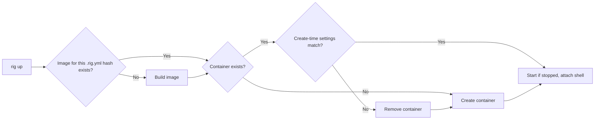

# Rig

**Instant, reproducible development environments for AI-assisted coding.**

Rig creates isolated Docker containers pre-configured with your language runtimes, build tools, and AI coding assistants. One command to enter a fully-equipped sandbox — no manual setup, no "works on my machine" issues.

## Installing

Mac:
```
brew tap wfaler/tap
brew install wfaler/tap/rig
```

Other platforms:
- Have Go installed
- Run `make build`
- Move the `rig` binary to somewhere on your path

## Quick Start

```bash
cd your-project
rig init        # Creates .rig.yml
rig up          # Build and enter the container
```

That's it. You're in a container with your languages, tools, and AI assistants ready to go.

## Why Rig?

- **Zero Setup** — Define your stack in YAML, run `rig up`, and you're coding
- **AI Agents Ready** — Claude Code, Gemini CLI, OpenAI CLI and GitHub CLI pre-installed
- **Documentation Server** — Built-in markdown renderer with live-reload, mermaid diagrams, and dark/light themes
- **VS Code in Browser** — Optional code-server with language extensions, auto-configured
- **Testcontainers Support** — Docker-in-Docker works out of the box (**without** privileged mode)
- **Persistent Sessions** — Your container persists between sessions; instant startup after first build
- **Auto-Rebuild** — Change your config, and the image rebuilds automatically next time you enter

## Why Rig and not Dev Containers?

VS Code Dev Containers are powerful, but they come with trade-offs that Rig avoids:

| | Rig | Dev Containers |
|---|---|---|
| **Config complexity** | Single `.rig.yml` (~10 lines) | `devcontainer.json` + Dockerfile + features |
| **IDE lock-in** | Any editor, terminal, or browser | VS Code (or compatible editors) |
| **AI assistants** | Claude Code, Gemini, OpenAI CLI pre-installed | Manual setup required |
| **Setup time** | `rig init && rig up` | Configure JSON, choose features, debug builds |
| **Testcontainers** | Works out of the box | Requires manual Docker-in-Docker setup |
| **Branch switching** | Same container, instant | Often rebuilds per branch |

### One container, all branches

Dev Containers are often tied to your Git branch or workspace state. Switch branches and you might trigger a rebuild — or worse, lose your installed dependencies and cached builds.

Rig containers are **project-scoped, not branch-scoped**. The container persists based on your `.rig.yml` config hash, not which branch you're on. Switch from `main` to `feature-x` to `hotfix-123` — you're still in the same warm container with all your tools ready. Rebuilds only happen when your environment config actually changes.

### Opinionated so you don't have to be

Dev Containers give you maximum flexibility — and maximum decisions. Rig makes sensible choices:

- **One version manager**: Mise for most languages, SDKMAN for JVM
- **One shell**: Zsh with Oh My Zsh (or bash/fish if you prefer)
- **One base image**: Debian Bookworm, battle-tested
- **Pre-wired for AI**: Every container is ready for AI-assisted development

### Terminal-native, IDE-optional

Rig is built for developers who live in the terminal. Run `rig up` and you're in a shell with everything ready. Want VS Code? Enable `code_server` and open it in your browser — on any machine, any OS.

Dev Containers assume you're opening your project in VS Code. Rig assumes you might be SSHing from an iPad, pairing over tmux, or running Claude Code headless on a CI server.

## Commands

| Command | Description |
|---------|-------------|
| `rig up` | Enter the container (builds if needed) |
| `rig down [name]` | Stop the container (preserves state) |
| `rig destroy [name]` | Stop container and remove all images |
| `rig list` | List running rig containers |
| `rig init` | Create `.rig.yml` template |
| `rig rebuild` | Remove the container and all of the project's images, then build a fresh image |

Inside a container, `rig-update` updates the toolchain and AI agents without a rebuild (see [Updating Tools Without Rebuilding](#updating-tools-without-rebuilding)).

## Configuration

Create `.rig.yml` in your project root:

```yaml
languages:
  node:
    version: "lts"
    build_systems:
      yarn: true
      pnpm: "8.15"       # specify version
  python:
    version: "3.12"
    build_systems:
      poetry: "1.8.0"
      pip: true
  java:
    version: "21"
    build_systems:
      gradle: "8.5"
      maven: true

ports:
  - "3000"
  - "5432:5432"

env:
  API_KEY: "${API_KEY}"  # Expands from host environment

shell: zsh  # zsh with oh-my-zsh (default), bash, or fish

markdown_server:
  enabled: true          # off by default
  port: 3030

code_server:
  enabled: true
  theme: "Default Dark Modern"
  extensions:
    - github.copilot

neovim:
  config:
    repo: https://github.com/you/dotfiles.git
    path: .config/nvim
```

### Supported Languages

| Language | Versions | Build Systems |
|----------|----------|---------------|
| **Node** | lts, latest, specific (e.g., "20") | npm, yarn, pnpm |
| **Python** | latest, specific (e.g., "3.12") | pip, poetry, pipenv, uv |
| **Go** | latest, specific (e.g., "1.22") | built-in |
| **Java/Kotlin/Scala** | latest, specific (e.g., "21") | gradle, maven, sbt, ant |
| **Rust** | latest, specific (e.g., "1.75") | cargo |
| **Ruby** | latest, specific (e.g., "3.3") | bundler, gem |

### Accessing Host Services

Rig containers can connect to services running on your host machine (databases, APIs, etc.) using the hostname `host.docker.internal`. This works on all platforms.

```bash
# Inside the rig container
psql -h host.docker.internal -p 5432 -U myuser mydb
```

No additional configuration needed — `host.docker.internal` is available in every rig container by default.

## Documentation Server

Rig can run a built-in markdown server that renders your project's `.md` files as navigable HTML. It is off by default; enable it and open `http://localhost:3030`.

- **Live-reload** — Edit markdown in your editor, see changes instantly in the browser
- **File navigation** — Collapsible directory tree sidebar
- **Mermaid diagrams** — Fenced `mermaid` code blocks render as diagrams
- **Light/dark theme** — Toggle with persistent preference

```yaml
markdown_server:
  enabled: true
  port: 4040             # optional, default: 3030
```

Setting only `port` does not enable it; `enabled: true` is required.

## Code Server (VS Code in Browser)

Enable `code_server` to get a full VS Code experience in your browser:

```yaml
code_server:
  enabled: true
  port: 8080                    # default, auto-exposed
  theme: "Default Dark Modern"  # any VS Code theme
  extensions:
    - golang.go                 # Go
    - ms-python.python          # Python
    - github.copilot            # AI assistant
```

Run `rig init` to see recommended extensions for each language.

## Neovim

Every rig container has the latest Neovim, installed through mise, and `vi` and `vim` open it. They are small wrappers in `/usr/local/bin` rather than shell aliases, so they also work for scripts, `git commit` and `sudo vim`; Debian's Vim is still available as `/usr/bin/vim`.

Point rig at your config and it is baked into the image, ready on first launch:

```yaml
neovim:
  config:
    repo: https://github.com/you/dotfiles.git  # https git URL
    path: .config/nvim                         # optional: directory in the repo
    ref: main                                  # optional: branch or tag
```

At build time rig clones the repository (only `path`, via a sparse checkout), links it to `~/.config/nvim`, and pre-initialises it in headless Neovim:

- **Plugins** — lazy.nvim plugins at the versions in your `lazy-lock.json`. A plugin that fails to install fails the build.
- **Mason tools** — the packages in an NvChad config's `mason.pkgs`, filtered to the project's languages using Mason's own language metadata, so a Go project gets `gopls` and `goimports` but not `jdtls`. Tools that serve no particular language (such as `tree-sitter-cli`) and Lua tools (for editing the config) are always installed. Failures are reported and skipped.
- **Treesitter parsers** — the parsers your config installs on startup (nvim-treesitter `main` branch) are built and waited for.

Steps that don't apply to your config (no lazy.nvim, no Mason list) are skipped. The repository is cloned without credentials, so it must be public. `rig-update neovim` pulls the config and re-runs the same steps, moving plugins to your updated `lazy-lock.json`.

Without `config`, Neovim runs with its defaults. To leave it out entirely:

```yaml
neovim:
  enabled: false
```

## Running Inside herdr

[herdr](https://herdr.dev) is a terminal multiplexer for AI coding agents. When you run `rig up` inside a herdr-managed pane, rig wires the containerized agent into herdr automatically:

- **Agent detection** — rig sets `HERDR_AGENT` (default `claude`) on itself so herdr can detect the agent through the container. It does this by re-executing with the variable set, since herdr reads it from the foreground process.
- **Socket access** — herdr's control socket is reachable inside the container at `/run/herdr/herdr.sock`, and `HERDR_SOCKET_PATH`, `HERDR_ENV`, and the pane/workspace/tab IDs are injected into your shell. So `herdr pane current`, `herdr pane split`, etc. work from inside the sandbox exactly as they do on the host.
- **CLI + skills** — the herdr CLI (single static binary), the herdr agent skill, and rig's own `rig-sandbox` skill are baked into the image, so an agent like Claude Code can spawn and monitor other agents over the socket API.
- **Background work status** — herdr reads Claude Code's state from the screen, so once a turn ends it shows the pane as idle even while background shells, subagents, monitors or workflows are still running. Rig installs a Claude Code hook that tells herdr the pane is still working, with a count such as `2 background tasks (shell, subagent)`, until that work is done. See [below](#background-work-status).

This is enabled by default and only activates when herdr is present. Configure or disable it in `.rig.yml`:

```yaml
herdr:
  enabled: true      # default; set false to omit the herdr CLI + skills
  agent: claude      # HERDR_AGENT value: claude, gemini, or codex
```

If your agent isn't detected, make sure you launched `rig up` from within a herdr pane (`HERDR_ENV=1`). You can also set it explicitly: `HERDR_AGENT=claude rig up`.

### Spawning sandboxed sessions

New herdr panes are spawned by herdr on the **host**, so by default a pane created from inside a container would be an unsandboxed host shell. Rig closes that gap so agents can delegate work without escaping the sandbox:

- Every container exposes `RIG_HOST_WORKDIR` — the host path mounted at `/workspace`.
- The bundled `rig-sandbox` skill teaches agents the pattern: split a pane with `--cwd "$RIG_HOST_WORKDIR"`, run `rig up` in it, and wait for the container shell before sending any work.

```bash
# From inside a rig container:
herdr pane split --direction right --cwd "$RIG_HOST_WORKDIR" --no-focus   # note pane_id
herdr pane run <pane_id> "rig up"
herdr pane wait-output <pane_id> --match "/workspace" --timeout 120000
herdr pane run <pane_id> "make test"    # runs inside the sandbox
```

The same `--cwd` joins the same project container (shared filesystem, separate shell); a different project's host directory gets that project's own container.

### Background work status

Claude Code's `Stop` hook lists the background work still in flight when a turn ends. Rig's hook, at `/usr/local/share/rig/rig-herdr-claude-hook.sh`, is registered in the container's `~/.claude/settings.json`:

- **On `Stop`** — with background work in flight, it reports the pane as `working` to herdr, which takes precedence over herdr's screen detection. With none, it hands the pane back.
- **On `UserPromptSubmit`, `StopFailure`, `SessionEnd`, and permission or MCP input prompts** — it hands the pane back to screen detection, which already handles turns, prompts and interrupts correctly.

When background work finishes, Claude Code is woken to handle its result, and the `Stop` at the end of that turn updates the status. Two cases are not tracked: a background task you stop from `/tasks` while Claude is idle leaves the pane showing `working` until your next prompt, and a permission prompt raised by a background subagent while the main turn is idle may show as `working` rather than `blocked` for its first few seconds.

The hook adds its entries alongside any hooks of your own and does nothing outside herdr. It needs an image built by this version of rig; run `rig rebuild` once to add it to an existing project.

rig does not install herdr's own Claude integration (`herdr integration install claude`). It only reports the session ID so herdr can resume Claude after a herdr restart, and that resume would run `claude --resume` in a host pane, outside the container.

### How the socket reaches the container

On **Linux**, the herdr socket is bind-mounted directly — unix sockets work across bind mounts when host and container share a kernel.

On **macOS**, unix sockets cannot cross the Docker VM boundary (the bind-mounted file appears, but connecting to it fails — true of OrbStack and Docker Desktop alike). Rig bridges instead: the host `rig up` process listens on a deterministic loopback TCP port and forwards to the socket, while `socat` inside the container re-exposes it at `/run/herdr/herdr.sock`. This is automatic; the only visible difference is that in-container herdr access requires a `rig up` session to be attached (which is the only time it's meaningful anyway).

## Updating Tools Without Rebuilding

Every image ships a `rig-update` script, generated from your `.rig.yml`, that updates the toolchain and AI agents inside a running container:

```bash
# Inside the rig container
rig-update              # run every step
rig-update --list       # show the steps this container has
rig-update claude npm   # run only some steps
```

It covers Debian packages (including the Docker and GitHub CLIs), mise and its runtimes (including Neovim), SDKMAN, Claude Code, the npm-installed agents, your build systems, your Neovim config and its plugins and tools, herdr (re-registering rig's Claude Code status hook), code-server and Oh My Zsh, depending on what your config enables. Steps run in dependency order, so packages installed into a runtime are reinstalled after that runtime is upgraded. A failing step doesn't stop the others; the summary names the failed steps and how to re-run them.

Pinned versions are respected: a runtime pinned to `1.22` only moves within `1.22.x`, and a build system pinned to an exact version stays there. Java itself is never upgraded, because it's always pinned.

Images built by older rig versions don't include `rig-update`. Run `rig rebuild` once in each project to add it; changing only the rig binary doesn't trigger a rebuild, because the image tag comes from `.rig.yml` alone.

Updates live in the container, not the image. They survive `rig down` / `rig up`, but not a recreation (after a `.rig.yml` change or `rig rebuild`), which starts again from the image. Services started with the container, such as the documentation server and code-server, keep running their old versions until the container restarts.

## Claude Code Memory and Sessions

Claude Code keeps per-project state — its auto-memory and the session transcripts `claude --resume` uses — under `~/.claude/projects`, which lives in the container and would be lost whenever the container is recreated. Rig links that directory to `.rig/claude/projects` in your project instead, so Claude's continuity survives `.rig.yml` changes and `rig rebuild`.

- `.rig/` contains a `.gitignore` of `*`, so it stays out of version control without touching your own `.gitignore`. Transcripts record everything said in a session, so don't commit them.
- Only `projects/` is linked. Credentials stay in the container, so you may need to log in again after a recreation.
- State already in the container is moved into `.rig/` the first time the link is made.

This is enabled by default. To keep the state in the container only:

```yaml
claude:
  persist_state: false
```

## What's Inside

Every rig container includes:

- **AI Assistants**: Claude Code, Gemini CLI, OpenAI CLI, GitHub CLI
- **herdr Integration**: herdr CLI + agent skills for orchestrating agents and spawning sandboxed sessions from inside a herdr pane
- **Documentation Server** (optional): Live-reload markdown renderer with mermaid support
- **Neovim**: Latest release, optionally with your config pre-initialised
- **Dev Tools**: git, curl, wget, jq, vim, tmux, build-essential
- **Docker CLI**: For testcontainers and Docker workflows
- **Version Managers**: Mise (polyglot) and SDKMAN (JVM)
- **Shell**: Zsh with Oh My Zsh (default), bash, or fish
- **`rig-update`**: Updates all of the above in place, without rebuilding the image

## How It Works



1. **Config Hash** — Your `.rig.yml` is hashed to create a unique image tag
2. **Smart Builds** — Images only rebuild when config changes
3. **Persistent Containers** — Named `rig-<project>`, reused across sessions
4. **Socket Mounting** — The container engine socket is mounted for testcontainers support
5. **Entrypoint Magic** — Permissions and services configured at container start

### When is the container recreated?

Some settings are fixed when a container is created, so `rig up` recreates the container when any of them differ from what the current session needs:

- **Image**: `.rig.yml` changed, or the image was rebuilt. Rig compares image IDs, not names, so an engine reporting names differently (Podman shows `rig-foo:tag` as `docker.io/library/rig-foo:tag`) does not count as a change.
- **Engine socket**: you switched engines, or the socket moved.
- **herdr wiring**: you started rig inside or outside herdr, or the socket or bridge port changed.
- **User namespace mode**: for example, moving between rootless Podman and Docker.

`rig up` always tells you whether it built an image and why it's replacing a container:

```
Using existing image rig-myapp:e2af40132020 (.rig.yml unchanged since it was built)
Recreating container rig-myapp, as its create-time settings changed:
  - engine socket: /var/run/docker.sock -> /run/user/1000/podman/podman.sock
```

Recreating a container discards anything changed inside it outside `/workspace`, including updates made with [`rig-update`](#updating-tools-without-rebuilding).

### Docker and Podman

Rig talks to the engine through the Docker API, so both **Docker** and **Podman** work on Linux and macOS. Podman needs its Docker-compatible socket running — with rootless Podman on Linux, that is:

```bash
systemctl --user enable --now podman.socket
export DOCKER_HOST=unix://$XDG_RUNTIME_DIR/podman/podman.sock
```

For Docker-in-Docker (testcontainers), rig bind-mounts the engine socket at `/var/run/docker.sock` inside the container. The path *outside* the container varies by engine, so rig resolves it rather than assuming:

| Setup | Socket rig mounts |
|---|---|
| Docker on Linux | `/var/run/docker.sock` |
| Rootless Docker | `$XDG_RUNTIME_DIR/docker.sock` |
| Rootless Podman | `$XDG_RUNTIME_DIR/podman/podman.sock` |
| Rootful Podman | `/run/podman/podman.sock` |
| macOS (Docker Desktop, OrbStack, Podman machine, Colima) | `/var/run/docker.sock` inside the engine VM |

`DOCKER_HOST` wins when it points at a unix socket rig can reach. On Linux, candidates that cannot be reached are skipped — under rootless Podman, `/var/run/docker.sock` is often a symlink to the root-owned `/run/podman/podman.sock`, and mounting it fails container creation with `statfs /var/run/docker.sock: permission denied`. On macOS the engine runs in a VM with its own filesystem, so the conventional in-VM path is used.

If no socket can be reached, rig still starts the container and prints a note — everything works except testcontainers and the in-container `docker` CLI. Switching engines changes the mount, so rig recreates the container automatically on the next `rig up`.

Podman lists locally built images under qualified names (`docker.io/library/rig-foo`, or `localhost/rig-foo`). Rig handles this: it checks whether an existing container is up to date by image ID, and `rig rebuild` and `rig destroy` clean up images under any of these names.

### Security: No Privileged Mode

Rig does **not** run containers in privileged mode. Instead, it mounts the engine socket into the container. This approach:

- **Avoids privileged mode** — No elevated kernel capabilities or direct root access to the host
- **Uses the host's engine** — Containers you create are siblings, not nested children
- **Works with Testcontainers** — Pre-configured environment variables ensure compatibility

This is safer than true Docker-in-Docker (which requires `--privileged`), while still enabling full Docker workflows inside your development environment.

For maximum isolation (working with untrusted code), run rig inside a VM — just install Docker or Podman in the VM and run rig as normal.

Note that rootless Podman is itself an isolation improvement: the engine runs as your user rather than root, so a container that reaches the socket cannot trivially become root on the host.

## Building from Source

```bash
git clone https://github.com/wfaler/rig.git
cd rig
make build
```

Requires Go 1.22+ and Docker or Podman.

## License

MIT
